# PC CAD View

Browser-based 3D CAD viewer for the pjcroft web tools, aimed at sheet metal assemblies.
Files are processed in the visitor's browser; nothing is uploaded.

## Screenshots

**Design: build a sheet metal part, see the flat pattern, export DXF**
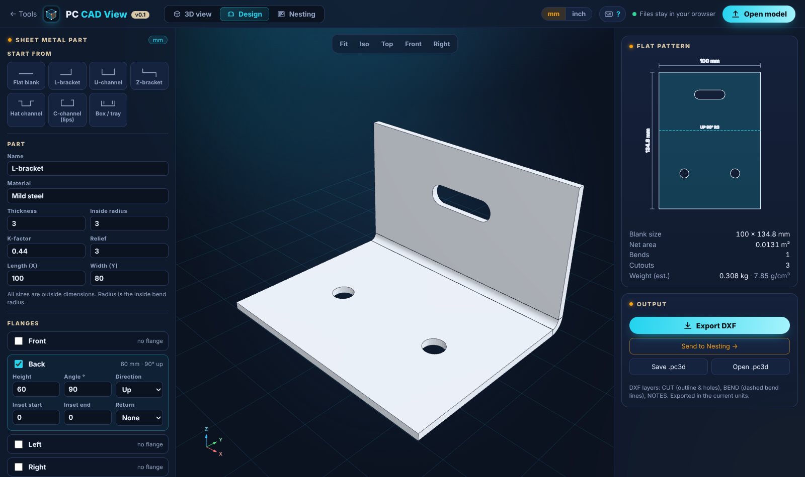

**3D view: sheet metal part with file properties (material, thickness, flat blank)**
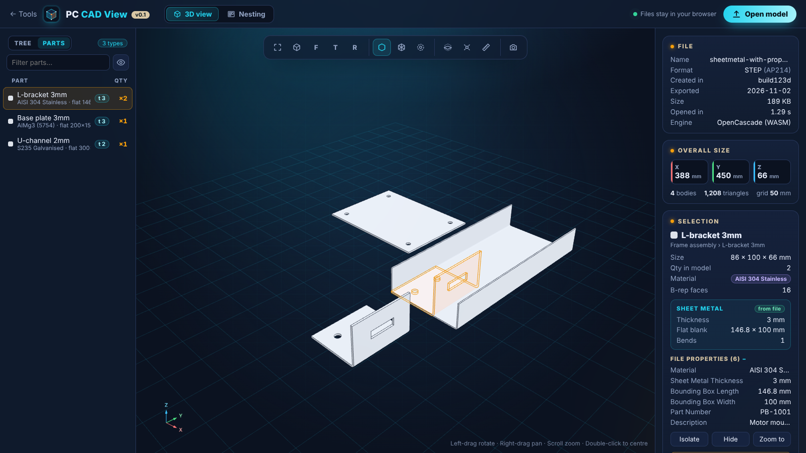

**Nesting: how many blanks fit on one sheet**
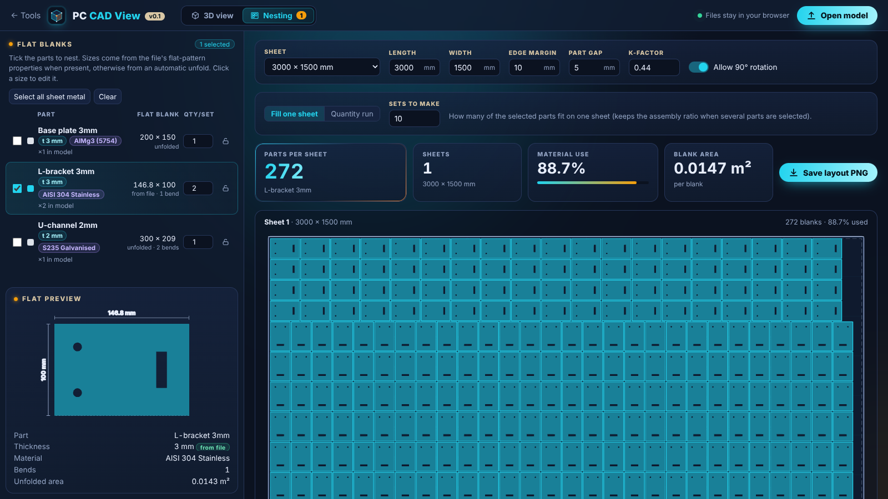

**Nesting: sheets needed for a production run**
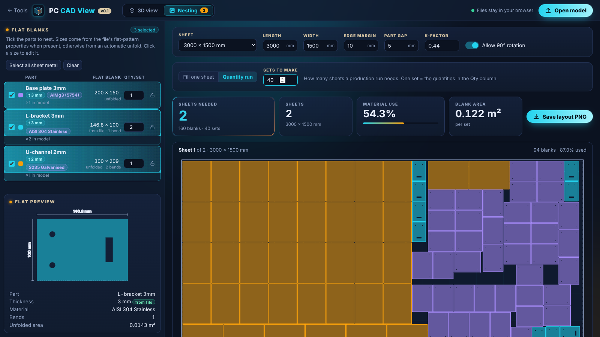

**Inch-drawn model: detected automatically, shown in inches**
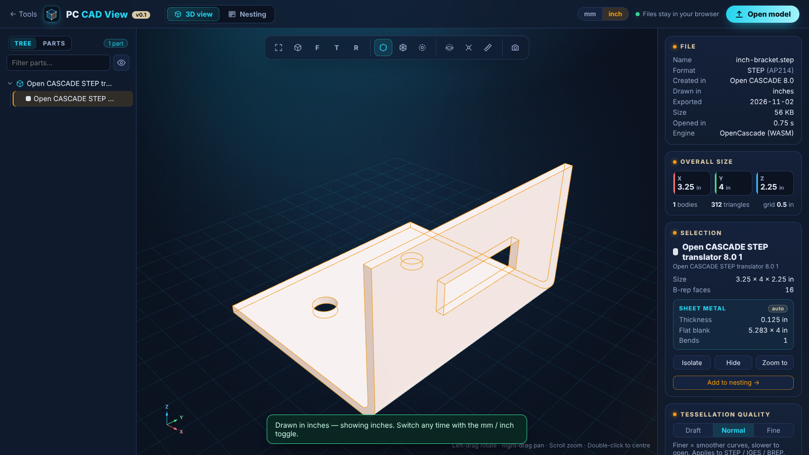

<table>
<tr>
<td width="50%"><b>Inch nesting on a 120 × 60 in sheet</b><br>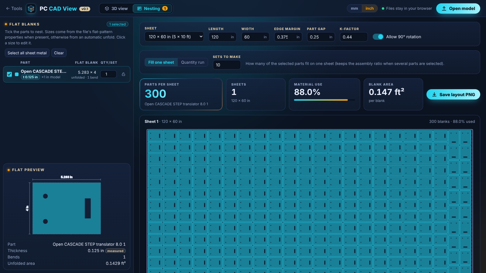</td>
<td width="50%"><b>Face down: upside-down part flipped flanges-up</b><br>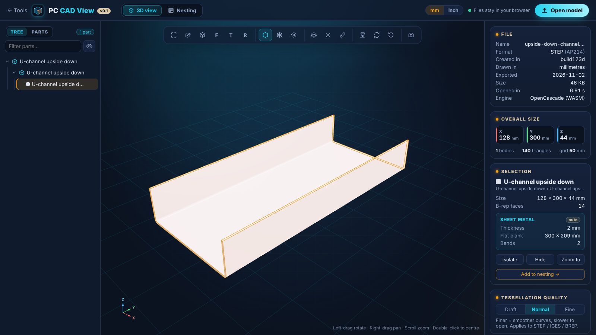</td>
</tr>
<tr>
<td><b>Where the orientation buttons are</b><br>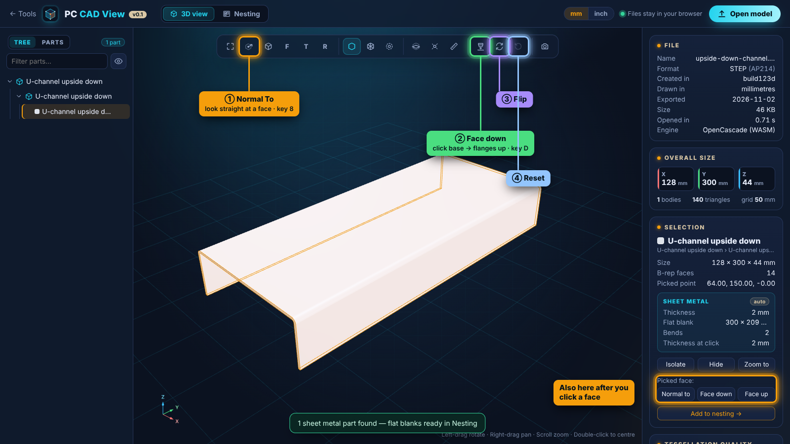</td>
<td><b>Section view</b><br>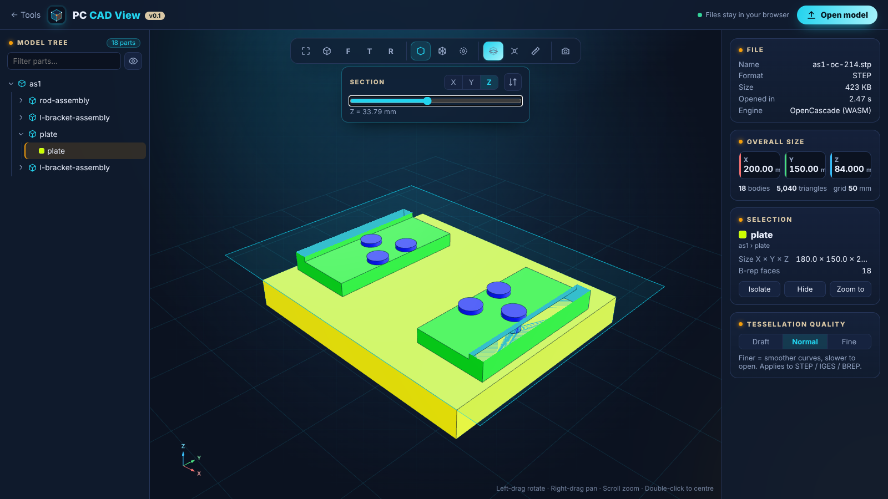</td>
</tr>
<tr>
<td><b>Start screen</b><br>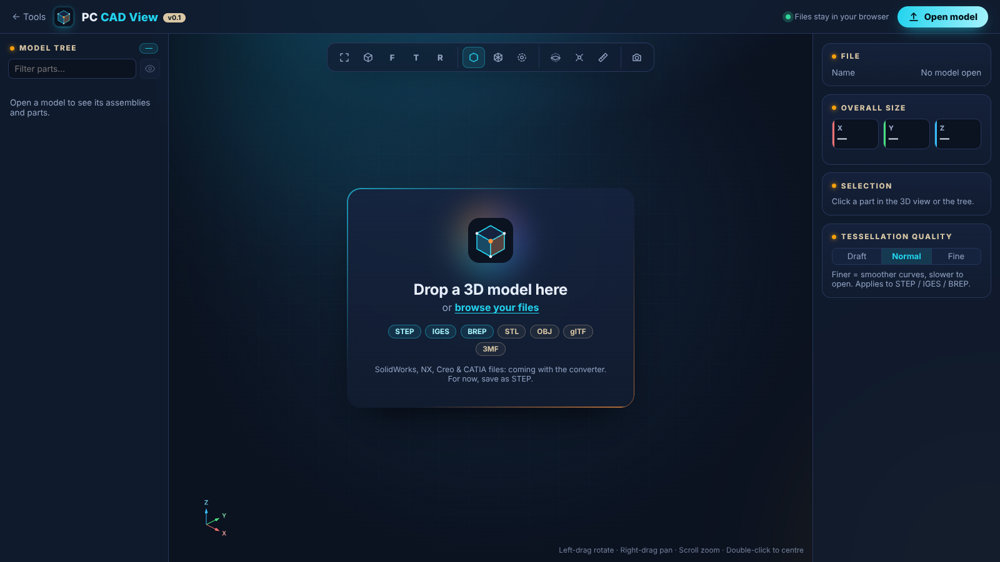</td>
<td><b>Shortcuts &amp; controls (? button or ? key)</b><br>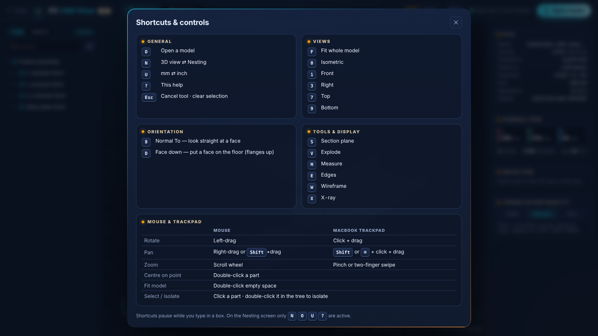</td>
</tr>
<tr>
<td><b>Loading dialog (240-part assembly)</b><br>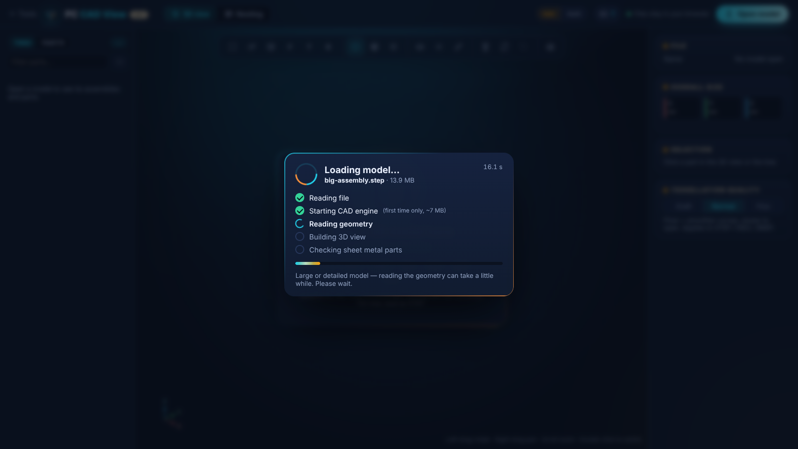</td>
<td><b>Design: hat channel with returns</b><br>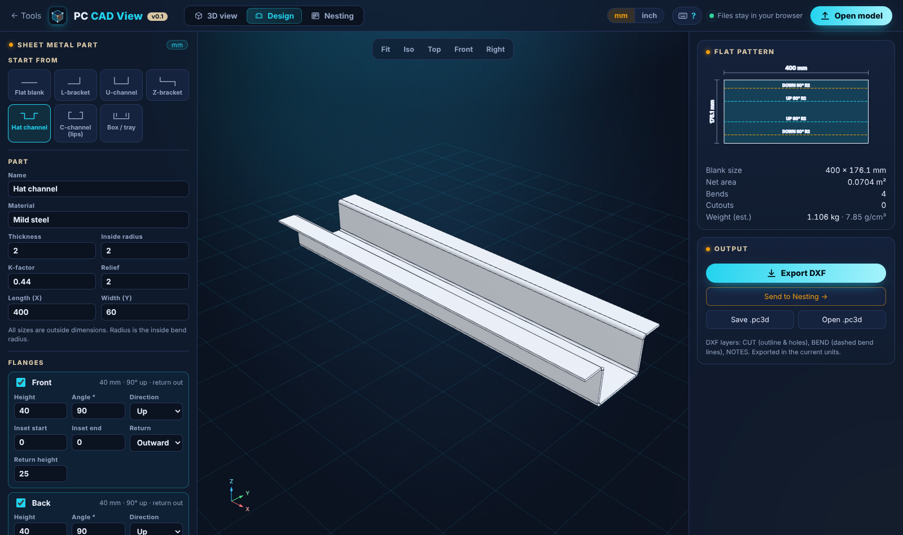</td>
</tr>
<tr>
<td><b>Designed part sent to Nesting</b><br>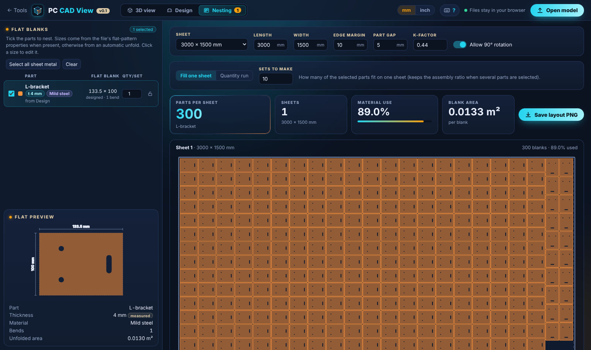</td>
<td></td>
</tr>
</table>

## Features (v0.1)
- **Sheet metal Design screen**: start from flat / L / U / Z / hat / C-channel / box-tray templates; set
  thickness, inside radius, K-factor, relief and outside sizes; flanges on any edge (height, angle, up/down,
  insets, optional inward/outward return); holes, slots and rectangular cutouts on the base or flanges;
  live 3D + exact flat pattern (bend allowance θ·(r + K·t)) with UP/DOWN bend lines, blank size, area and
  weight; **DXF export** (R12, layers CUT / BEND / NOTES, mm or inch); **Send to Nesting**; save / open
  designs as **.pc3d** files (also opens from the Open button or by drag-and-drop)
- Open **STEP / IGES / BREP** (OpenCascade WASM) and **STL / OBJ / glTF / 3MF**
- Assembly tree + parts list with quantities; filter, show/hide, isolate
- **Normal To** (look straight at a clicked face), **Face down / Face up** (re-orient the model so a face sits
  on the floor — fixes sheet metal drawn upside down), flip 180°, reset orientation
- **Loading dialog** that blocks the app until the model is fully ready: step checklist, progress bar,
  elapsed time, parts counter (big assemblies can finish the sheet metal check in the background)
- **Shortcuts & controls** cheat sheet: keyboard button in the header or press **?**
- Section plane, explode, point-to-point measure, edges / wireframe / X-ray, PNG screenshot
- **STEP metadata**: material, density, thickness, part number, SolidWorks/Inventor custom properties, source CAD system
- **Sheet metal**: auto thickness detection, thickness at a clicked point, flat blank X × Y
  (from the file's flat-pattern properties, else automatic unfold with K-factor)
- **Metric / imperial**: detects the unit a STEP model was drawn in (mm or inch) and switches the display to
  match; mm | inch toggle (key U) converts every length, input and sheet preset. STL/OBJ follow the current unit.
- **Nesting**: "how many fit on one sheet" and "sheets for N sets", 90° rotation with per-part lock,
  margin/gap, sheet presets, layout PNG export

## Develop
```
npm install
npm run dev        # http://localhost:5173
npm run build      # -> dist/
node --experimental-strip-types test/unfold.test.mts                          # unfold accuracy (mm parts)
node --experimental-strip-types test/unfold.test.mts samples/inch-bracket.step # unfold accuracy (inch part)
node --experimental-strip-types test/nest.test.mts     # nesting checks
node --experimental-strip-types test/design.test.mts   # designer: flat blanks, 3D sizes, DXF
```

## Deploy on the Debian box (static files only)
Copy `dist/` to the web root, e.g. `/var/www/pjcroft/pc-cad-view/`. With Caddy:
```
pjcroft.ddnsfree.com {
    root * /var/www/pjcroft
    encode zstd gzip
    file_server
}
```
`.wasm` is served as `application/wasm` by Caddy/nginx by default. The app uses relative paths,
so it works from any sub-folder. Add a card to the tools home page linking to `pc-cad-view/`.

## Limits
- SolidWorks / NX / Creo / CATIA native files need a server-side converter (planned); export STEP for now.
- Unfold is an estimate (straight bends, no reliefs/bend tables); file flat-pattern properties win when present.
- Nesting packs rectangles; true-shape CAM nesting can fit a few more irregular parts.
